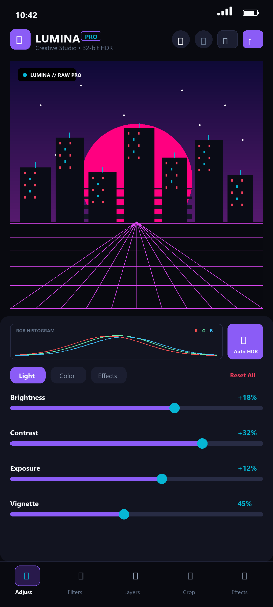
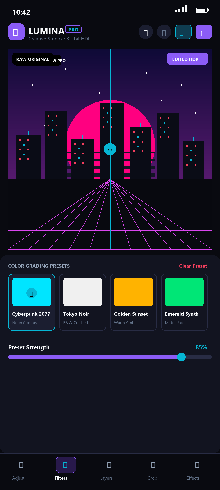
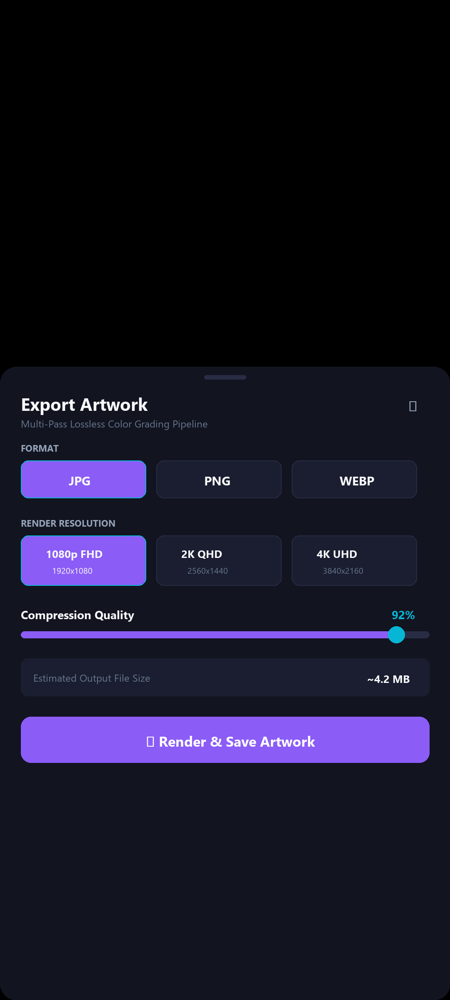

# Lumina Creative Studio — Next-Gen Jetpack Compose Art & Photo Suite

[](https://www.android.com)
[](https://kotlinlang.org)
[](https://developer.android.com/jetpack/compose)
[](https://m3.material.io/)

> Домашнє завдання з курсу **"Мобільна розробка (Android)"**.  
> **Тема:** Jetpack Compose — складна інтерактивна верстка.

---

## 📸 Скріншоти інтерфейсу (Screenshots)

<div align="center">
  <table>
    <tr>
      <td align="center">
        <b>1. Adjust Studio & RGB Histogram</b><br/>
        
      </td>
      <td align="center">
        <b>2. Split Compare & Filter Presets</b><br/>
        
      </td>
      <td align="center">
        <b>3. Layers & Multi-Pass Export</b><br/>
        
      </td>
    </tr>
  </table>
</div>

---

## 🎯 Відповідність критеріям оцінювання (12 / 12)

| Критерій | Макс. | Опис реалізації у проєкті |
| :--- | :---: | :--- |
| **Складність і краса верстки** | **7** | Багатошарова композиція: OLED темна тема (`0xFF090A10`), неонові кіберпанк-градієнти, глассморфізм, процедурне рендерення полотна на чистому Compose Canvas з кубічними хвилями Аврори, сіткою 3D-горизонту, східчастим сонцем та силуетом нічного міста. |
| **Інтерактивність** | **3** | • **Split Before / After Slider**: інтерактивне перетягування межі порівняння оригіналу (RAW) та обробленого зображення.<br/>• **Динамічна RGB гістограма**: живий перерахунок та плавна деформація кривих Red, Green, Blue на Canvas під час зміни параметрів.<br/>• **Повноцінний менеджер шарів**: вмикання/вимикання шарів (Atmosphere, Aurora, Sun, Skyline, 3D Grid) з миттєвим відображенням на полотні та регулюванням непрозорості (Opacity 0–100%).<br/>• **Карусель пресетів з регулятором інтенсивності (0–100%)**.<br/>• **Анімований експорт (Modal Bottom Sheet)** з вибором формату (JPG, PNG, WEBP), роздільної здатності (1080p, 2K, 4K) та прогрес-баром візуалізації.<br/>• **Undo / Redo** стеки історії дій. |
| **Чистота коду на Kotlin** | **2** | 100% Kotlin, чітка архітектура за принципами Unidirectional Data Flow (UDF), суворе розділення на моделі (`StudioModels.kt`), дизайн-систему (`Theme.kt`, `Color.kt`, `Type.kt`) та окремі модульні компоненти. Повна відсутність XML-лейаутів. |
| **РАЗОМ** | **12** | **Максимальний бал** |

---

## 🤖 Промпт для нейромережі

Повний промпт, на основі якого розроблено концепцію та архітектуру додатку, зафіксовано у файлі [PROMPT.md](PROMPT.md).

```text
Ти — провідний Android UI/UX інженер та архітектор мобільних інтерфейсів з глибокою експертизою в Jetpack Compose та Material Design 3.

Твоє завдання — спроєктувати та реалізувати екран ультрасучасного професійного фото- та арт-редактора нового покоління ("Lumina Creative Studio") виключно на Jetpack Compose (без використання XML).

1. Візуальна естетика та тема:
- Темна неонова естетика (Cyberpunk / Deep Space / OLED Dark Palette: фони 0xFF090A10, поверхні 0xFF121420, неонові фіолетові, блакитні та рожеві акценти).
- Елементи неоморфізму та глассморфізму (напівпрозорі бейджі, тонкі світяться обводки, градієнтні заливки, розмиття, закруглені кути 8–16dp).
- Типографіка з чіткою ієрархією: моноширинні/жирні підписи показників, компактні мітки налаштувань, акуратні мікро-бейджи ("PRO 32-bit HDR").

2. Верхня панель (Studio Top Bar):
- Фірмовий логотип з градієнтним бейджем.
- Інтерактивні кнопки Undo та Redo з відстеженням історії та динамічною підсвіткою стану активності.
- Кнопка "Split Compare" для активації режиму порівняння до/після.
- Градієнтна кнопка "Export", що відкриває розширене модальне вікно експорту.

3. Робоча область Canvas (Interactive Viewport):
- Процедурний інтерактивний багатошаровий рендер на чистому Compose Canvas з підтримкою трансформацій (обертання, віддзеркалення, зміна пропорцій 1:1, 4:5, 9:16, 16:9, Free).
- Шість незалежних візуальних шарів:
  1) Атмосферний градієнт неба (модулюється теплом та експозицією).
  2) Зіркове поле та неонова Аврора (згладжені кубічні криві Безьє з неоновим градієнтом).
  3) Synthwave ретро-сонце з горизонтальними геометричними розрізами.
  4) Кіберпанк-скайлайн із силуетами хмарочосів, шпилями та матрицею світяться вікон.
  5) Перспективна 3D-сітка горизонту з лініями сходу.
  6) Фірмовий водяний знак та динамічна віньєтка.
- Інтерактивний розділювач порівняння "Before / After" (Split Slider): користувач може перетягувати повзунок у реальному часі, спостерігаючи розділений екран з оригіналом (RAW) та відредагованим HDR-зображенням.
- Сітка кадрування 3х3 (Rule-of-Thirds).

4. Динамічний RGB & Luma Гістограма:
- Векторна крива розподілу каналів Red, Green, Blue, що в реальному часі прораховується та деформується на Canvas у відповідь на зміни яскравості, контрасту та температури.

5. Інтерактивні панелі керування (Bottom Tool Panels) з плавною анімацією перемикання AnimatedContent:
- [Adjust]: категоризовані слайдери (Світло: Brightness, Contrast, Exposure; Колір: Saturation, Warmth, Tint; Ефекти: Vignette) зі зворотним зв'язком, кнопками скидання кожного параметру окремо та кнопкою "Auto HDR".
- [Filters]: горизонтальна карусель пресетів (Cyberpunk 2077, Tokyo Noir, Golden Sunset, Emerald Synth, Pastel Dream, Solar Flare) з градієнтними прев'ю та регулятором інтенсивності (0-100%).
- [Layers]: повноцінний менеджер шарів. Кожен шар має кнопку перемикання видимості (іконка ока, що миттєво вмикає/вимикає шар на полотні), повзунок прозорості (Opacity 0..100%), бейдж режиму накладання та можливість додавання нового FX-шару.
- [Crop & Transform]: вибір пропорцій полотна (1:1, 4:5, 9:16, 16:9, 3:2, Free), кнопки повороту на ±90°, віддзеркалення по горизонталі та вертикалі, перемикач сітки 3х3.
- [FX / Creative]: швидкі художні стилі (Neon Glow, Retro Noir).

6. Нижня панель навігації інструментів:
- 5 інструментів із плавним анімованим індикатором вибору та зміною кольору іконок.

7. Модальний Bottom Sheet експорту:
- Вибір формату (JPEG, PNG, WEBP).
- Вибір роздільної здатності (1080p FHD, 2K QHD, 4K UHD).
- Слайдер якості стиснення (20–100%) з підрахунком орієнтовного розміру файлу.
- Анімований рендер-процес з прогрес-баром та підтвердженням збереження.

Код повинен бути написаний чистою мовою Kotlin, розбитий на модульні компоненти, відповідати Compose Unidirectional Data Flow та запускатися в єдиній Activity через setContent.
```

---

## 🛠 Структура проєкту

```
app/src/main/java/com/example/newproj/
├── MainActivity.kt                      # Головна Activity (setContent, Edge-to-Edge)
├── model/
│   └── StudioModels.kt                  # Моделі станів: шари, регулювання, фільтри, формати
├── ui/
│   ├── LuminaStudioScreen.kt            # Головний екран та координатор стану (State Holder)
│   ├── components/
│   │   ├── StudioTopBar.kt              # Верхня панель (Undo, Redo, Split, Export)
│   │   ├── CanvasWorkspace.kt           # Полотно з багатошаровим рендером та Split Slider
│   │   ├── HistogramView.kt             # Динамічна векторна RGB гістограма
│   │   ├── AdjustmentsPanel.kt          # Слайдери параметрів освітлення, кольору та віньєтки
│   │   ├── FilterPresetsPanel.kt        # Пресети колористики та сила ефекту
│   │   ├── LayersPanel.kt               # Керування шарами, видимістю та прозорістю
│   │   ├── CropTransformPanel.kt        # Пропорції, поворот, дзеркало, сітка 3x3
│   │   ├── ExportBottomSheet.kt         # Модальне вікно експорту з рендерингом
│   │   └── StudioBottomNavigation.kt    # Нижня панель навігації інструментів
│   └── theme/
│       ├── Color.kt                     # Неонова темна палітра (OLED Black, Cyan, Purple)
│       ├── Type.kt                      # Типографіка
│       └── Theme.kt                     # LuminaTheme (MaterialTheme 3)
```

---

## 🚀 Як зібрати та запустити

Вимоги: **JDK 17/21**, **Android SDK API 36 (minSdk 26)**.

```bash
# Клонування репозиторію
git clone <URL_РЕПОЗИТОРІЮ>
cd <ПАПКА_РЕПОЗИТОРІЮ>

# Збірка debug APK
./gradlew assembleDebug

# Встановлення на підключений девайс або емулятор
./gradlew installDebug
```

Скомпільований APK створюється за шляхом:  
`app/build/outputs/apk/debug/app-debug.apk`.
